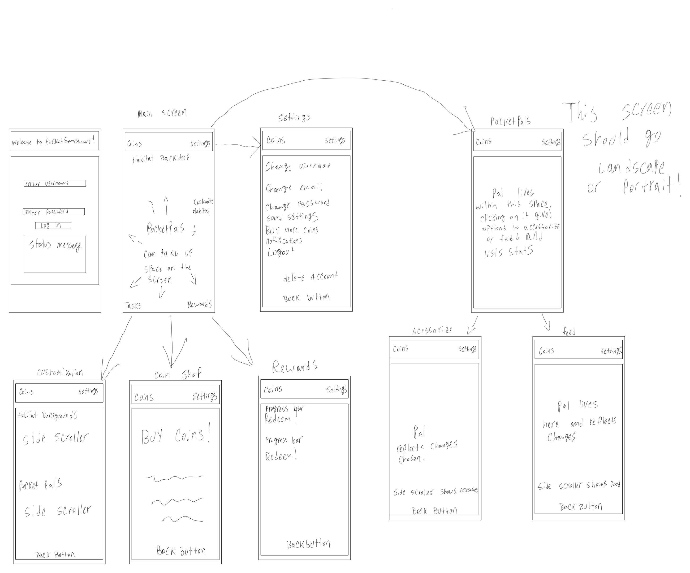
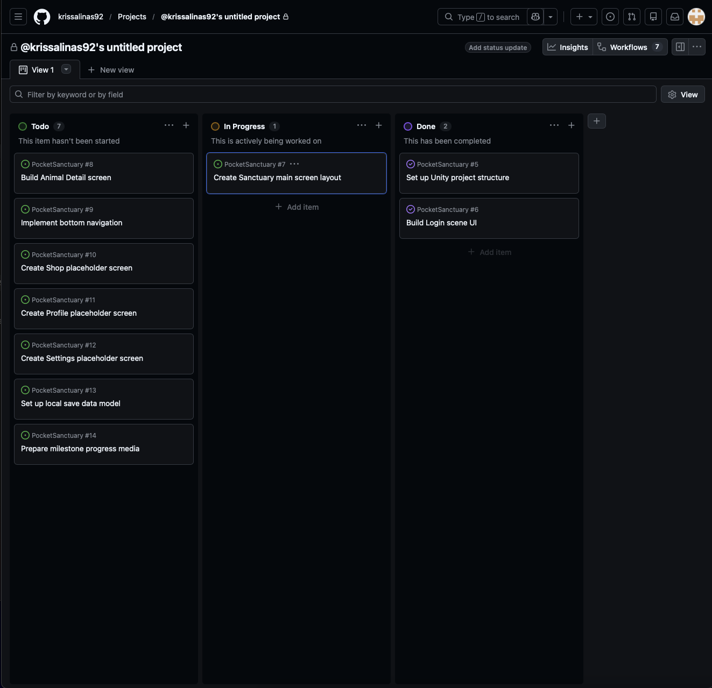
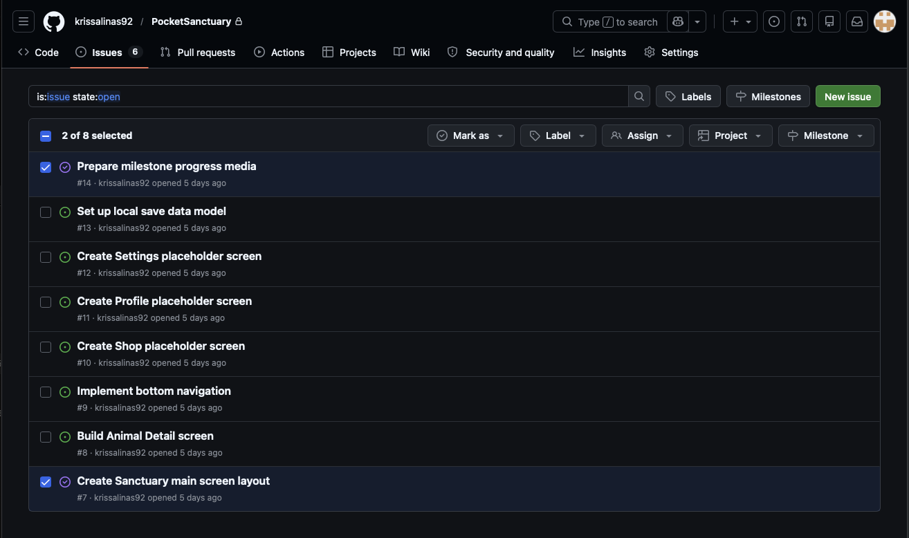
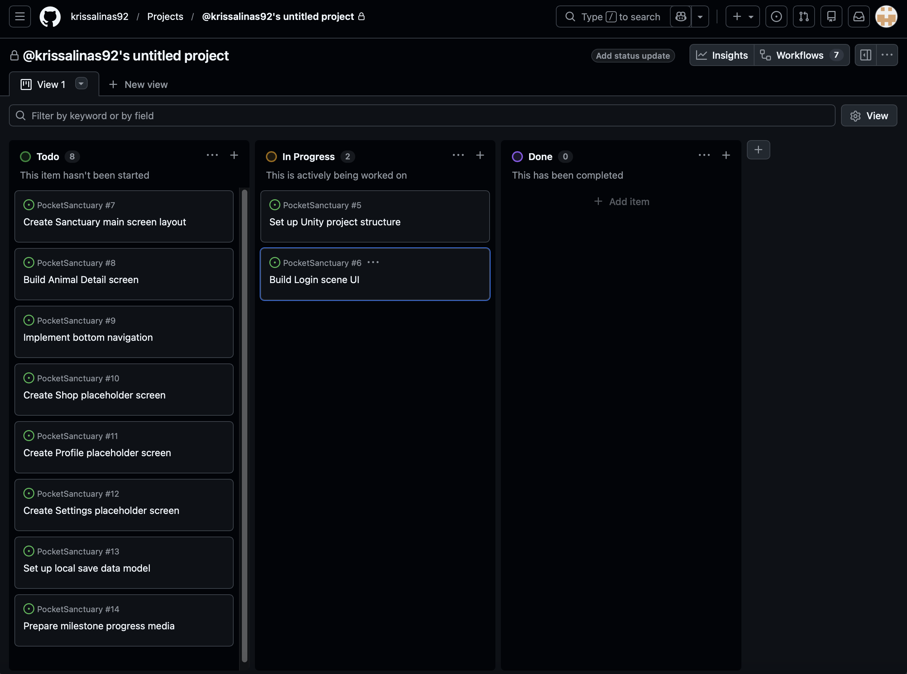
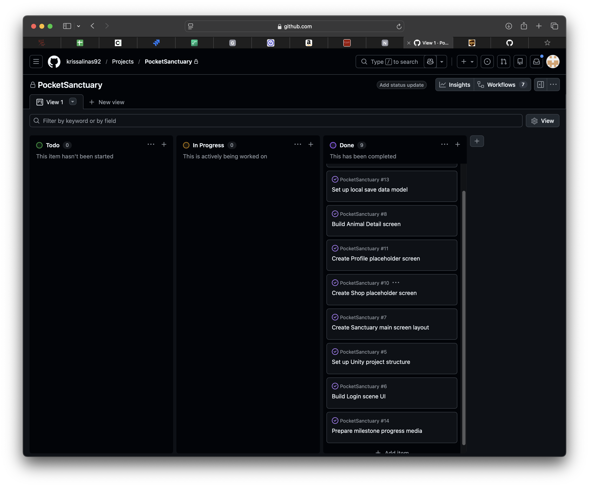

# Milestone 1 - Pocket Sanctuary (Unit 7)

## Table of Contents

1. [Overview](#Overview)
1. [Product Spec](#Product-Spec)
1. [Wireframes](#Wireframes)

## Overview

### Description

Pocket Sanctuary is a cozy mobile animal-raising game built in Unity where players log in, collect exotic animals, care for their needs, and grow a peaceful sanctuary over time.

### App Evaluation

[Evaluation of your app across the following attributes]
- **Category:** Gaming / Simulation / Entertainment
- **Mobile:** Designed for mobile-first play with touch interactions, audio feedback, push notifications, short check-in sessions, and device orientation that work well on Android devices
- **Story:** Players build a relaxing sanctuary filled with rare and lovable animals, creating a comforting experience centered around care, customization, and progression
- **Market:** Animal lovers, casual mobile gamers, and fans of cozy collecting or pet simulation games
- **Habit:** Players are encouraged to return often to log in, feed animals, clean habitats, collect rewards, and unlock new animals and decorations
- **Scope:** Milestone 1 focuses on planning a realistic MVP with a login screen, main sanctuary loop, animal care interactions, and supporting wireframes

## Product Spec

### 1. User Features (Required and Optional)

**Required Features**

1. User can log in from a dedicated opening screen before entering the game
2. User can view and manage multiple exotic animals in their sanctuary
3. User can interact with animals through actions like feeding, playing, and cleaning
4. User can navigate across at least five app screens including login, sanctuary, animal detail, shop/customization, and profile/settings
5. User progress is saved, including animal status, unlocked items, and sanctuary customization

**Optional Features**

1. Push notifications that remind the player when animals need attention
2. Additional habitats or biomes that unlock as the sanctuary grows
3. Daily rewards, streaks, and special events for repeat engagement

### 2. Screen Archetypes

- Login
  - User enters their credentials to access their sanctuary
  - User starts the app experience from a clear first screen
- Stream
  - User sees the main sanctuary with animals, tasks, and rewards
  - User returns here frequently as the primary gameplay screen
- Detail
  - User selects an animal to view stats such as hunger, happiness, and energy
  - User can perform care actions for that specific animal
- Creation
  - User customizes habitats, decorations, themes, or accessories
  - User personalizes the sanctuary and its animals
- Profile
  - User views progress, unlocked animals, and general account information
  - User tracks their sanctuary growth over time
- Settings
  - User manages sound, notifications, and other preferences
  - User can log out or adjust gameplay settings

### 3. Navigation

**Tab Navigation** (Tab to Screen)

* Login
* Sanctuary
* PocketPal
  -PocketPal Feed/Accesorize
* Shop
* TasksRewards
* Customization
* Settings

**Flow Navigation** (Screen to Screen)

- Login
  - User enters credentials and moves to the Sanctuary screen
  - User can log out later and return to the Login screen
- Sanctuary
  - User taps an animal to open the Detail screen
  - User opens the Shop or customization flow from the main habitat
- PocketPal
  - User performs feed or accesorize actions and returns to the Sanctuary screen
  - User can move between animal-specific actions and general habitat management
- Customize
  - User can customize their PocketPal and habitat backdrop
- Shop
  - User buys coin packs, accessories, or decorations and returns to the Sanctuary screen
  - User applies purchased items to animals or habitats
- TasksRewards
  - User reviews progress and navigates back to the Sanctuary or 
- Settings
  - Multiple settings

## Wireframes

[Add picture of your hand sketched wireframes in this section] 

 

 

### [BONUS] Digital Wireframes & Mockups

### [BONUS] Interactive Prototype

 

# Milestone 2 - Build Sprint 1 (Unit 8)

## GitHub Project board

[Add screenshot of your Project Board with three milestones visible in this section]

## Issue cards

- [Add screenshot of your Project Board with the issues that you've been working on for this unit's milestone] 

- [Add screenshot of your Project Board with the issues that you're working on in the **NEXT sprint**. It should include issues for next unit with assigned owners.] 

## Issues worked on this sprint

- Creating Sanctuary main layout
- Completed the login screen for the game
- Set up the initial Unity project structure and foundation for future development
- [Add giphy that shows current build progress for Milestone 2. Note: We will be looking for progression of work between Milestone 2 and 3. Make sure your giphys are not duplicated and clearly show the change from Sprint 1 to 2.]

 

# Milestone 3 - Build Sprint 2 (Unit 9)

## GitHub Project board

[Add screenshot of your Project Board with the updated status of issues for Milestone 3. Note that these should include the updated issues you worked on for this sprint and not be a duplicate of Milestone 2 Project board.] 

## Completed user stories

- List the completed user stories from this unit
- List any pending user stories / any user stories you decided to cut
from the original requirements

[Add video/gif of your current application that shows build progress]

## App Demo Video

- Embed the YouTube/Vimeo link of your Completed Demo Day prep video
